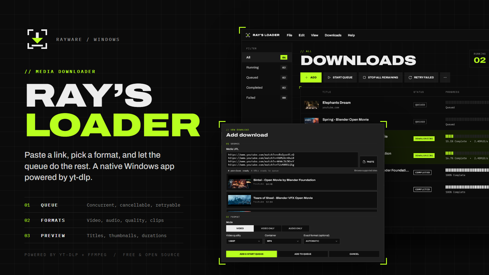
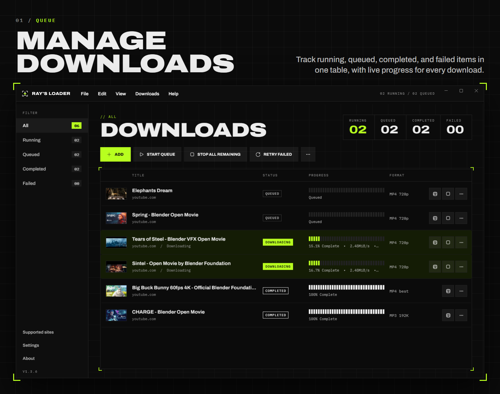
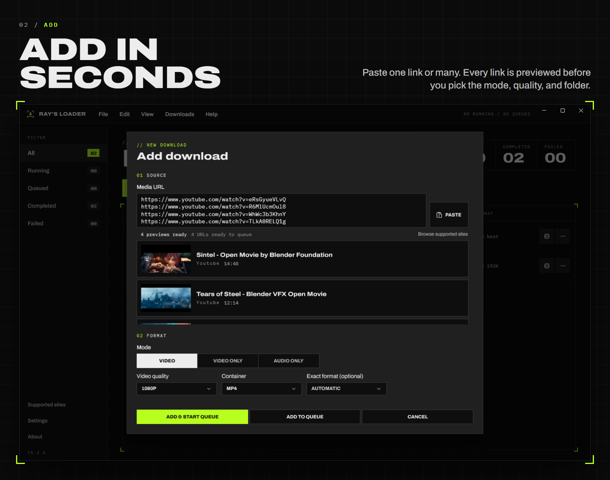
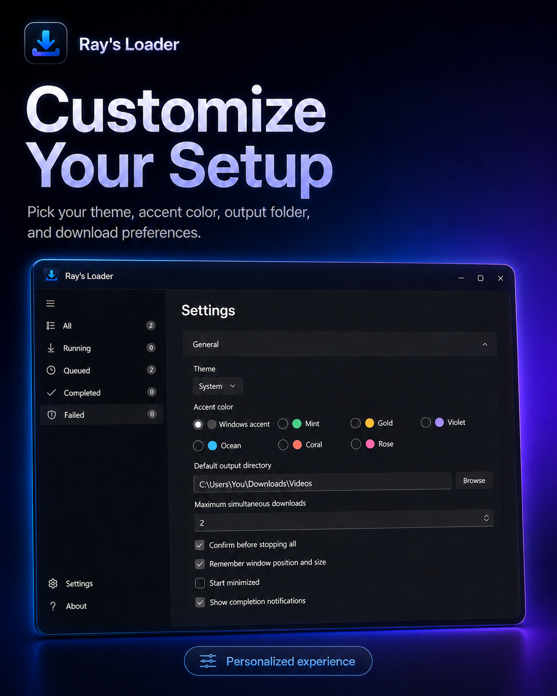

<p align="center">
  
</p>

# Ray's Loader

Ray's Loader is a modern Windows 11 media downloader powered by yt-dlp.

## Download

[Download the latest Windows installer](https://github.com/PKRReaperr/Rays-Loader/releases/latest/download/RaysLoader-Setup-1.0.1.exe)

Run the downloaded `.exe` and follow the installer. Windows may show a SmartScreen warning because the installer is not currently code-signed.

The primary application is a native C#/.NET 8 WinUI 3 desktop app. It provides a Fluent, resizable download queue; asynchronous media analysis; video, audio, playlist, subtitle, metadata, thumbnail, and clip downloads; per-item progress and live terminal logs; cancellation and retry; persistent settings; and selectable bundled or external yt-dlp/FFmpeg tools. Ray's Loader automatically enables a bundled Deno runtime or a compatible Node installation for modern YouTube extraction.

## Features

### Manage downloads

Track queued, running, completed, and failed items in one clean view.

<p align="center">
  
</p>

### Add downloads instantly

Paste links, choose formats, set quality, and send everything straight to the queue.

<p align="center">
  
</p>

### Customize your setup

Choose your theme, accent color, output folder, and download preferences.

<p align="center">
  
</p>

## Quick start

```powershell
dotnet restore RaysLoader.sln -p:Platform=x64
dotnet run --project src\RaysLoader\RaysLoader.csproj -c Debug -p:Platform=x64
```

For release builds, the installer, portable archive, tool layout, and troubleshooting, see [BUILDING.md](BUILDING.md).

Settings are stored in `%LOCALAPPDATA%\RaysLoader`. Portable builds deliberately use the same per-user location so they also work from read-only folders.

Ray's Loader is not affiliated with YouTube or any supported media website. Users are responsible for complying with applicable laws, website terms, and content rights.

## License

Ray's Loader is released under the [MIT License](LICENSE). Dependency licensing and attribution are listed in [THIRD-PARTY-NOTICES.md](THIRD-PARTY-NOTICES.md).
